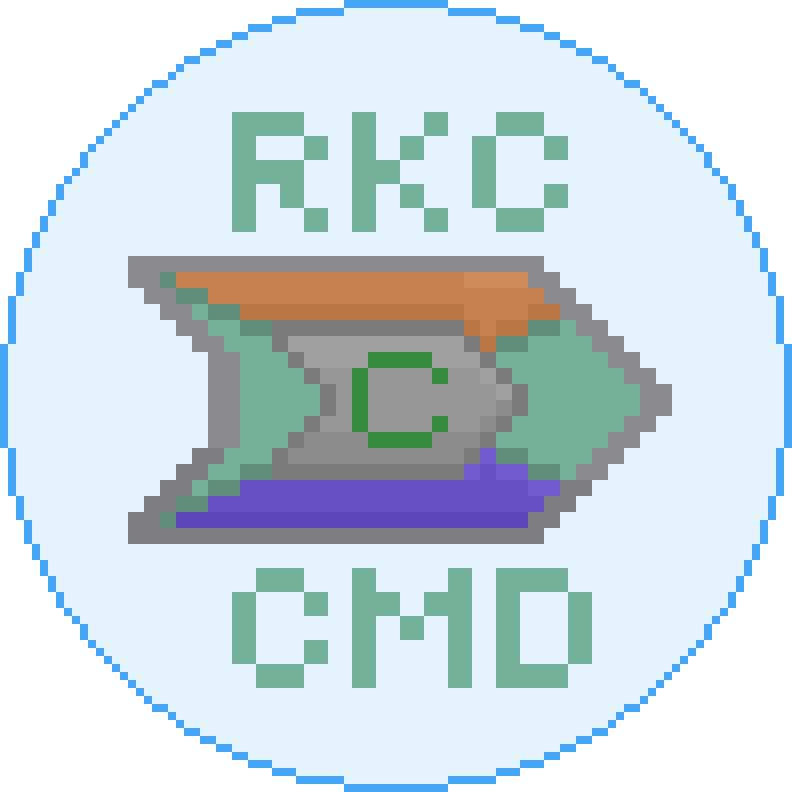

# RKCs

  관리 및 기록 시스템

 

[**RKCs**](#rkcs)는 [**R.K.C**](#rkc)의 현재 상태와 세계관을 관리 및 기록하기 위한 프로젝트입니다.

국가의 행정, 영토, 법률, 인구, 경제 / 인게임의 데이터 팩, 리소스 팩 등 다양한 정보를 체계적으로 관리하며, **R.K.C** 세계관 확장을 지원합니다.

## R.K.C
**R.K.C**(`Republic of Korean Commanders`)는 **대한민국 커맨더들의 공화국**의 약자로 가상 국가 컨셉을 지닌 커뮤니티입니다.

시민은 **R.K.C**의 역사, 문화, 행정 등 다양한 설정을 함께 만들어 나가며, `Minecraft`와 관련된 여러 프로젝트를 통해 협업하고 소통합니다.

### 국기

### 국장

### 정보
- 국가(歌): *Fulgor adamantis*(광휘의 금강석)
- 국화: *Oxeye daisy*(데이지)
- 국조(鳥): *Ender dragon*(엔더 드래곤)
- 언어: 한국어
- 통화: *δ*(델타)
- ccTLD: `.rkc`
- 국가 코드: `RKC`, `720`

### 환경
- [정부](/doc/Government.md)
- [법률](/doc/law/Law.md)
  - [영토](/doc/Territory.md)
- [역사](/doc/History.md)

---

## Minecraft Server R.K.C
- [Datapacks](/doc/minecraft/datapacks.md)
- [Resource Packs](/doc/minecraft/resourcepacks.md)
- [Mods](/doc/minecraft/mods.md)