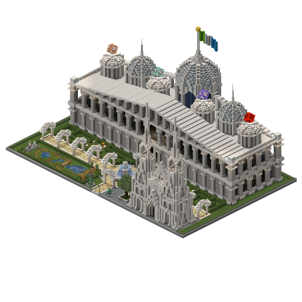
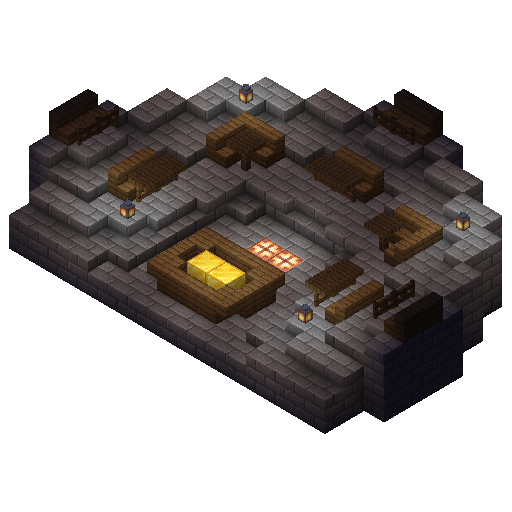

# 정부
**R.K.C**는 의장을 국가 수반으로 하는 의원내각제 국가이다.  
의장은 의회의 총괄이자 국가의 대표로서 국가 운영을 주재한다.

 
실제 건축물에서의 의회

- 청사
청사는 국가 운영에 필요한 주요 기관이 속한 구역이자 건물이다.

  
  
인게임 실제 청사

 

- 의회
의회는 청사에 속한 **R.K.C**의 모든 정책을 의결하는 최고 기관이다.  
모든 법률과 주요 정책은 의회의 심의와 의결을 거쳐 확정된다.

  
  
인게임 실제 의회

---

## 구성
### 의장 

의장은 **R.K.C**의 최고 공직자이다.  
의회에서 선출되며 국가를 대표한다.

#### 권한
- 법률 공포
- 정책 최종 결정

---

### 의원 

의원은 의회의 구성원으로서 입법을 책임한다.

#### 권한
- 법률 발의
- 의장 선출
- 행정의원 임명
- 공무원 임명

---

### 행정의원 

행정의원은 행정부 총괄을 책임한다.

#### 권한
- 정책 관리
- 행정부 운영
- 서버 관리

---

### 공무원 

공무원은 행정 실무를 직접적으로 책임한다.

#### 권한
- 정책 집행
- 시스템 운영
- 서버 관리
- 스레드 생성
- 포럼 생성 및 제거
- 시민 투표 실시