# 영토
**R.K.C**의 영토는 정부가 관할하는 모든 지리적 범위를 의미하며, 실질적 기반이 된다.

- 영토의 거래와 관련한 법률에 대해서는 [토지법](/doc/law/Land.md)을 참고하십시오.

## 범위
**R.K.C**의 영토는 월드보더(worldborder)에 의해 그 최대가 물리적으로 제한되며, 영토의 중심(8, 5, 0)을 기준으로 `x, z` `-3000 ~ 3001`이며, `y`로는 `-64 ~ 319`까지이다.

실제 인게임 영토

- overworld
  부동산에서 토지를 구매하여 이용할 수 있는 서버 주요 차원이다.

  

    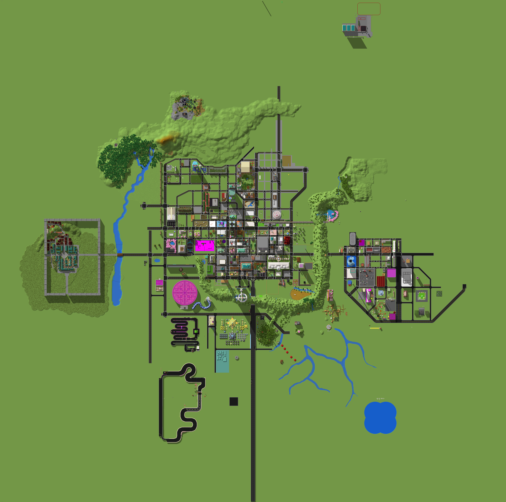
    
6048x6016

  

 

- practice
  법률이 적용되지 않는 실험 차원이다.

  

    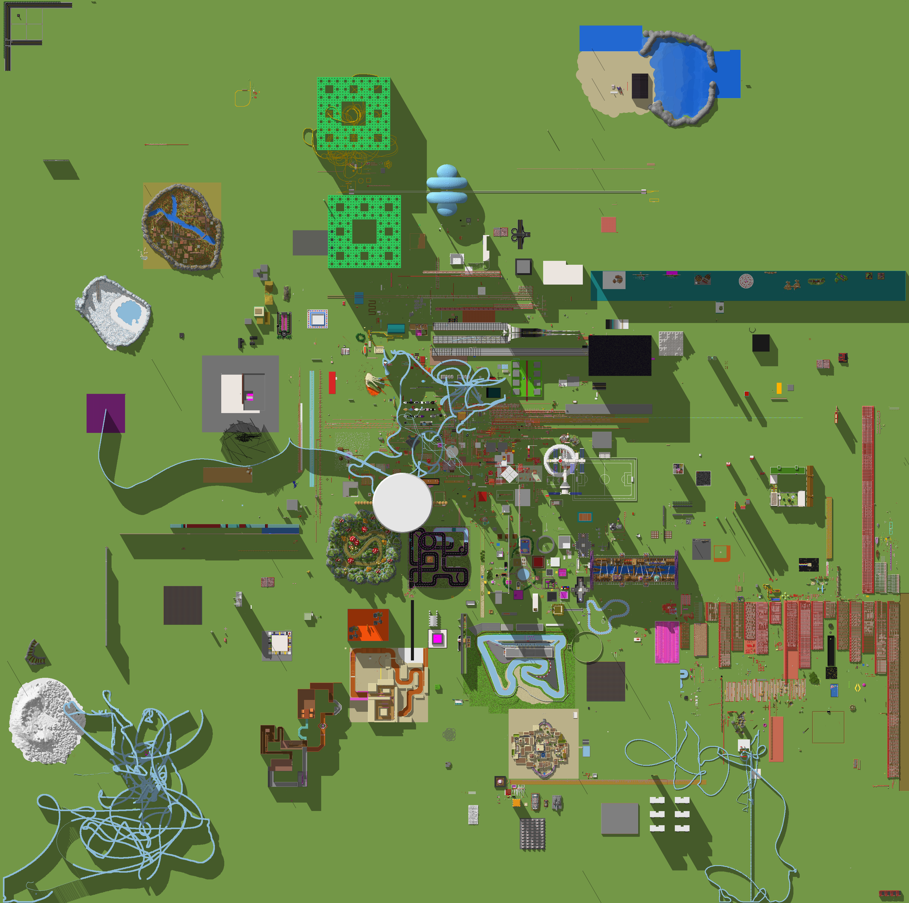
    
6048x6016

  

---

## 구성

### 차원
- minecraft:overworld
  - 창설: `2023. 8. 14`
- minecraft:practice
  - 창설: `2024. 1. 4`

### 수도
**R.K.C**의 수도는 행정 중심지이며, 다음과 같이 변천하였다.

- 구청사
  - 기간: `2023. 7. 20 - 2024. 4. 20`
  - 좌표: `8, 5, 37`

- 신청사
  - 기간: `2024. 4. 21 - 현재`
  - 좌표: `160, 5, 67`

### 도시
- 중앙시
  - 남구
  - 북구
- 자료시
- 뉴카오스시

---

## 구역

체계화된 도시의 건설과 행정 관리를 위해 **R.K.C**의 영토는 목적에 따라 여러 구역으로 구분된다.

정부

정부가 직접 관리하는 건물이다.

#### 구청사
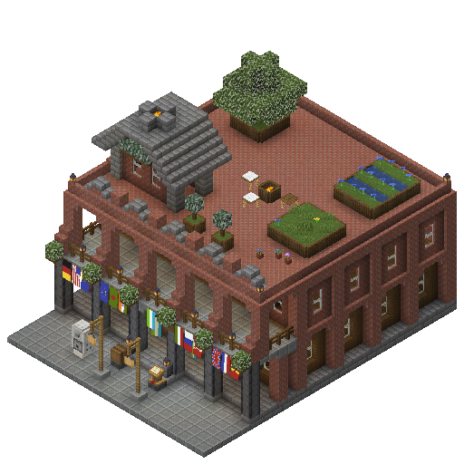

#### 신청사
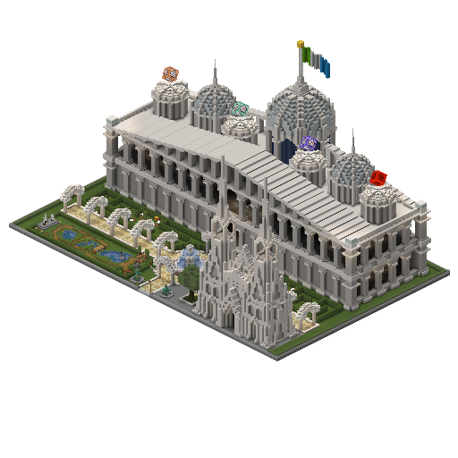

#### 은행
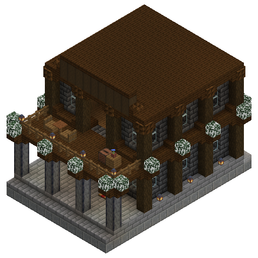

#### 방송국
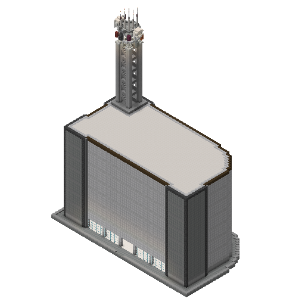

#### 중앙역
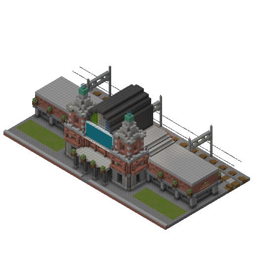

#### 명언의 분수
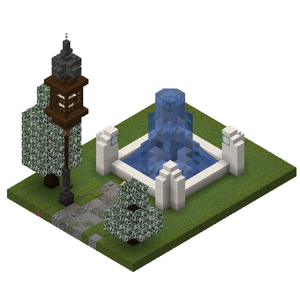

#### 병원
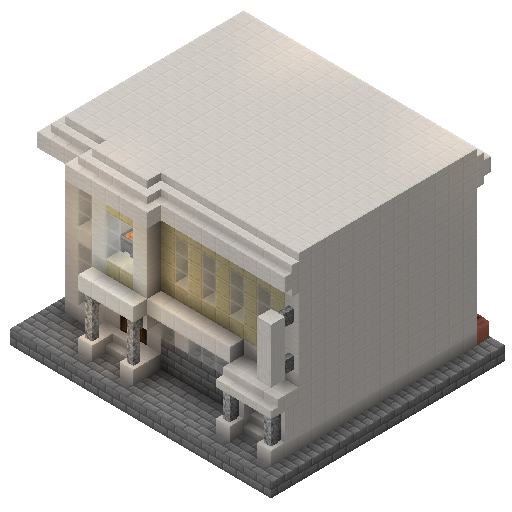

#### 안내소
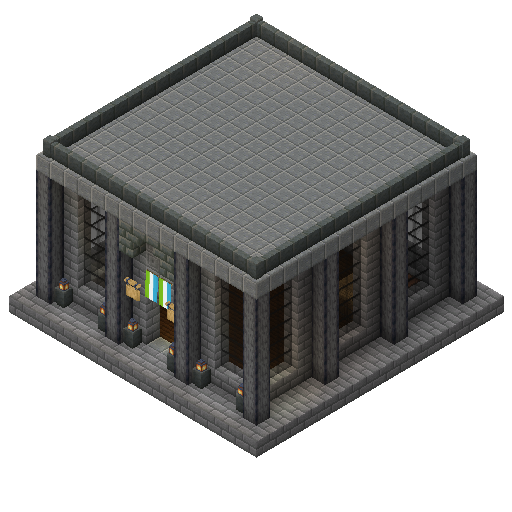

#### 공사관 단지
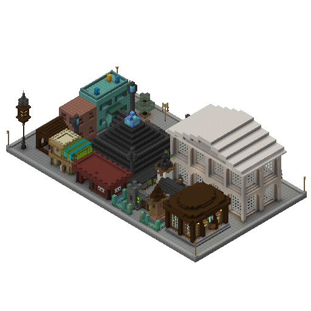

#### 로비
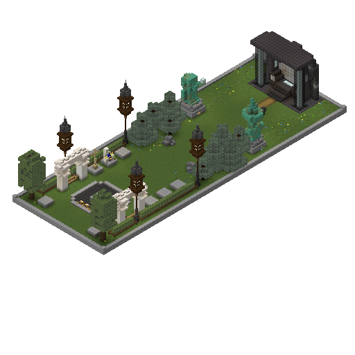

#### 박물관
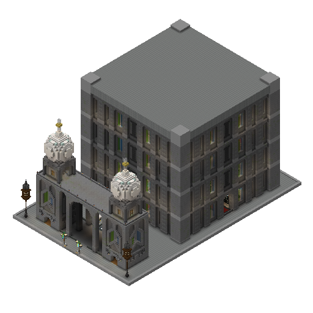

#### 경찰서
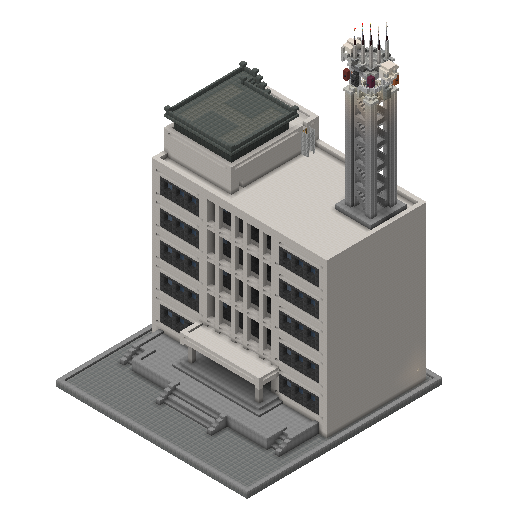

