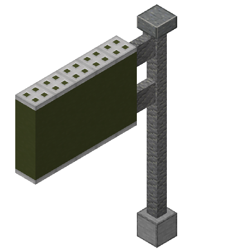
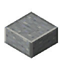
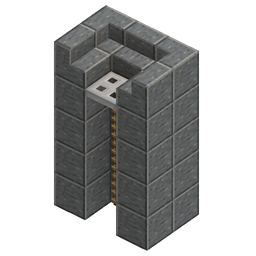
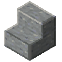
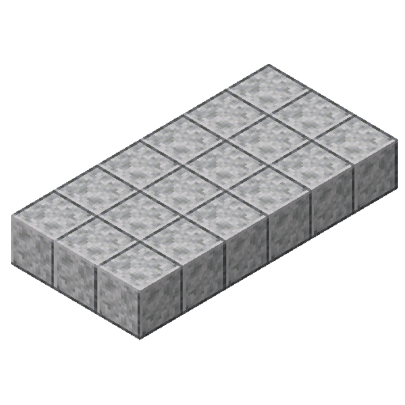
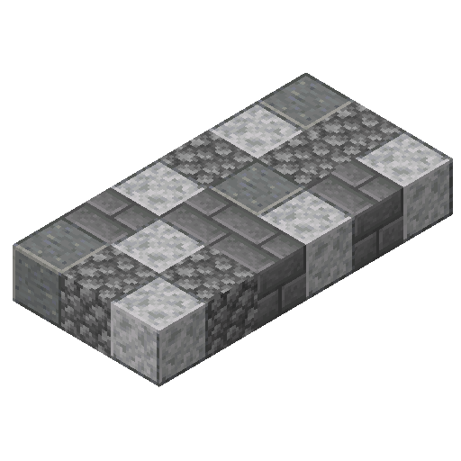
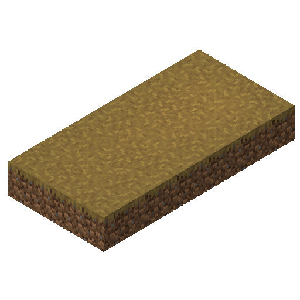

# 제1장 총칙
## 제1조(목적)

이 법은 도로의 건설 및 관리에 관한 사항을 규정함으로써 도로의 효율적인 개발과 체계적인 관리를 도모하고, 안전하고 편리한 교통 환경을 조성하여 시민의 이동과 공공복리 증진에 이바지함을 목적으로 한다.

# 제2장 도로의 종류
## 제2조(도로의 구분)

도로는 기능과 목적에 따라 다음과 같이 구분한다.

1. 국도
  가. 국가의 주요 지역을 연결하는 광역 도로

2. 고속국도
  가. 도시 간을 연결하는 고속 운행 도로

3. 생활도로
  가. 주거 지역을 연결하는 소규모 도로
  나. 시설물을 연결하는 저속 운행 도로

# 제3장 도로 건설 재료 및 시설 기준
## 제3조(도로 포장 재료)

도로의 포장에는 다음 블록을 사용하는 것을 원칙으로 한다.

| 용도 | 블록 |
|:---|:---:|
| 기초 지반 |  |
| 차도 |  |
| 중앙선 |  |
| 차선 |  |
| 경계석 |  |
| 가드레일(일반도로) |  |
| 가드레일(고속국도) |  |
| 정지선 |  |
| 횡단보도 |  |
| 중앙분리대(일반도로) |  |
| 중앙분리대(고속국도) |  |

## 제4조(도로 시설물)

도로에는 교통 안전과 이용 편의를 위하여 다음 시설물을 설치할 수 있다.

1. 가로등
    

가. 가로등 건설은 다음 블록을 사용하는 것을 원칙으로 한다.

    

    

    | 용도 | 블록 |
    |:---|:---:|
    | 기초 지반 |  |
    | 기둥 |  |
    | 목 |  |
    | 전등 |  |
    | 전원 |  |

2. 도로 교통 표지판
    

가. 도로 교통 표지판은 다음 블록을 사용하는 것을 원칙으로 한다.

    

    

    | 용도 | 블록 |
    |:---|:---:|
    | 기초 지반 |  |
    | 기둥 |  |
    | 지붕 |  |
    | 목 |  |
    | 도료판 |  |
    | 도료판덮개 |  |

3. 배수 시설
    

가. 배수 시설 건설은 다음 블록을 사용하는 것을 원칙으로 한다.

    

    

    | 용도 | 블록 |
    |:---|:---:|
    | 배수구 |  |
    | 배수로 |  |
    | 구배 유도판 |  |
    | 배수로 계단 |  |

4. 보도
    

가. 보도는 다음 블록을 사용하는 것을 원칙으로 한다.

     
    
    

    

    | 용도 | 블록 |
    |:---|:---:|
    | 인도 |  |
    | 석재 도로 |  +  +  + |
    | 흙 길 |  |

# 제4장 도로의 설계
## 제5조(도로 폭의 기준)

도로의 폭은 도로의 종류와 이용 목적에 따라 다음 기준을 따른다.

| 종류 | 차로 | 폭(중앙선 제외) |
|:---|:---:|:---:|
| 생활도로 | 1차 | 3 블록 이하 |
| 국도 | 왕복 2 ~ 4차 | 6 ~ 12 블록 |
| 고속국도 | 왕복 4차 이상 | 12 블록 이상 |

## 제6조(도로 지반 기준)

도로의 지반은 기상 현상과 자연 재해에 쉽게 무너지지 않는 암석 재질로 한다.  
이에 맞는 암석으로는 `매끄러운 돌`()이 있다.

1. 도로가 닿는 모든 부분에 매끄러운 돌을 설치한다.
2. 차도가 노출되는 부분은 경계석()으로 마감한다.

## 제7조(중앙분리대 설치 기준)

중앙분리대는 왕복 4차선 이상의 도로에 설치한다.  
단, `대나무 울타리`()는 [국도](#제2조도로의-구분)에서만 사용한다.

이 이상의 차선이나 [고속국도](#제2조도로의-구분)의 경우, `안산암 담장`()을 사용한다.

## 제8조(정지선 폭의 기준)

정지선은 왕복 2차선 이상의 도로에 설치한다.  
횡단보도와 2칸 떨어진 위치에 경계석()까지 정지선을 설치한다.